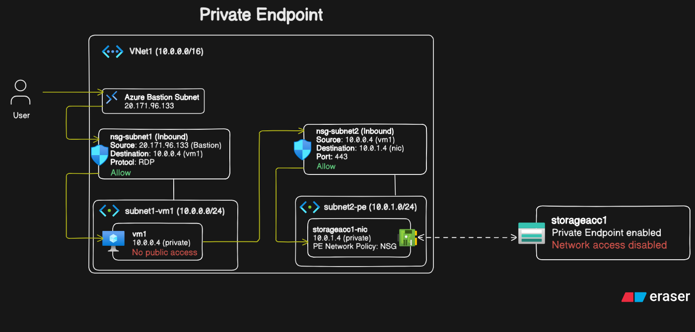

# Azure Private Endpoint Architecture & Lab

## Overview
This project demonstrates secure private connectivity to an Azure Storage Account using **Azure Private Endpoints**, **Azure Bastion**, and **Network Security Groups (NSGs)** inside an Azure Virtual Network. Public network access to both the VM and the Storage Account is completely disabled.

## Traffic Flow Narrative
1. **User Connection:** The administrator connects to the VM via **Azure Bastion** over TLS/HTTPS (Port 443) through the Azure Portal.
   
2. **Ingress Subnet1 NSG Evaluation:** `nsg-subnet1` intercepts inbound traffic from the Bastion host (20.171.96.133) targeting vm1 (10.0.0.4) over **RDP (Port 3389)** and allows the connection.
   
3. **Internal Egress to Private Endpoint:** Vm1 (10.0.0.4) initiates an HTTPS request to the Storage Account Private Endpoint NIC (10.0.1.4).
   
4. **Subnet2 NSG Evaluation:** `nsg-subnet2` validates the request, allowing source 10.0.0.4 over **Port 443**.
   
5. **Secure Storage Access:** Traffic passes through the Private Endpoint interface (storageacc1-nic) directly into storageacc1 over Microsoft's internal backbone, completely bypassing the public internet.

## Infrastructure Details
* **VNet:** 10.0.0.0/16
* **Subnet 1 (VM):** 10.0.0.0/24
* **Subnet 2 (PE):** 10.0.1.0/24
* **Storage Account Access:** Public Network Access Disabled (Private Endpoint Only)